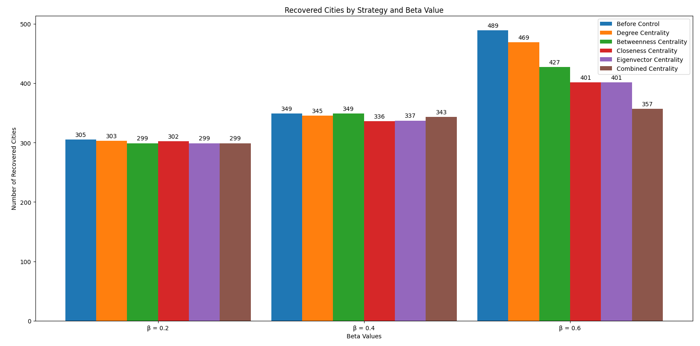

# Targeted Mosquito Control Using Network Theory and SIR Models

**Third-year engineering project report · SF5 · University of Cambridge · June 2024**

This repository contains my SF5 university report and the Python code supporting it. The project applies network theory and SIR modelling to explore how targeting a small number of cities could affect simulated disease spread, using mosquito control as the motivating example.

The work is a coursework application of established modelling methods. It is an illustrative simulation, rather than a validated model of a real outbreak.

**Author:** Kasia Dylewska

📄 **[Read the original report](reports/kad54_SF5_final_report-3.pdf)** · **[Methodology](methodology.md)**

## Project overview

The report explores how a city's position in a network affects transmission and compares ways of choosing cities for intervention. Cities are represented as nodes, with connections based on geographical distance. Temperature influences transmission, and centrality measures identify cities to target.

The simulations consider transmission parameters of 0.2, 0.4 and 0.6, starting with 200 randomly infected cities and targeting five cities. The report asks about the number of cities to target, but the surviving experiment uses a fixed budget of five.

## Method

1. Prepare city population, distance and temperature data.
2. Connect cities separated by at most 100 km.
3. Simulate transmission through susceptible, infected and recovered city states.
4. Rank cities by degree, betweenness, closeness and eigenvector centrality.
5. Combine the four normalised centralities and remove the five highest-ranked nodes.
6. Compare simulated outbreaks before and after removal.

The [methodology note](methodology.md) covers the equations, assumptions and differences between the report and code. Node removal is a simplified representation of control; the city simulation does not explicitly model mosquitoes.

## Results from the report



At transmission parameter 0.6, Figure 1 shows 489 final recovered cities before control and 357 with combined centrality removal. In this SIR simulation, final recovered cities count cities that were infected during the outbreak, so a lower count means a smaller simulated outbreak.

These are the original report results. The PDF contains inconsistent descriptions of which strategy performs best; the numerical comparison is discussed in [methodology.md](methodology.md). The historical random seed and full six-strategy comparison code are unavailable, so these values are not presented as independently reproduced results.

## Repository contents

```text
README.md                 Coursework overview
methodology.md            Models, assumptions and report results
reports/                  Original, unchanged PDF
figures/                  Figures extracted from the report
dengue_simulation/
  main.py                 Entry point for the combined-centrality experiment
  experiment.py           Data loading and run settings
  model.py                SIR and removal functions from the original code
  scripts/                Selected original supporting scripts
  data/                   Input instructions; datasets are not included
requirements.txt          Dependencies for the runnable experiment
```

## Running the code

The core code was checked with Python 3.12.7. Create a virtual environment, activate it, then install the dependencies:

```bash
python -m venv .venv
python -m pip install -r requirements.txt
python -m dengue_simulation.main --help
```

Activate with `.venv\Scripts\Activate.ps1` in Windows PowerShell, or `source .venv/bin/activate` on macOS/Linux, before installing.

With the three input CSVs described in [data/README.md](dengue_simulation/data/README.md):

```bash
python -m dengue_simulation.main --legacy-identifiers --seed 2024
```

This runs the available combined-centrality comparison and saves tables, a plot and run settings under `dengue_simulation/results/seeded/`. The seed is for this runner, not the original report. `--legacy-identifiers` retains the original city-name identifiers, including duplicate and missing names. A rerun can produce different values from the report.

City inputs were prepared from Simplemaps World Cities and temperature inputs through Meteostat, with synthetic seasonal fallback where weather was unavailable. The original CSV snapshot is not included because its redistribution terms have not been confirmed. A fresh clone therefore needs those inputs to run the geographical experiment. Original supporting scripts and their extra dependencies are explained in [scripts/README.md](dengue_simulation/scripts/README.md).

## Scope and acknowledgements

This project practised Python, mathematical modelling, stochastic simulation, graph analysis and visualisation. Its main limitations are the simplified distance network, temperature assumptions, incomplete historical reproducibility and lack of validation against observed outbreaks. The report discusses possible extensions using mobility and disease data.
