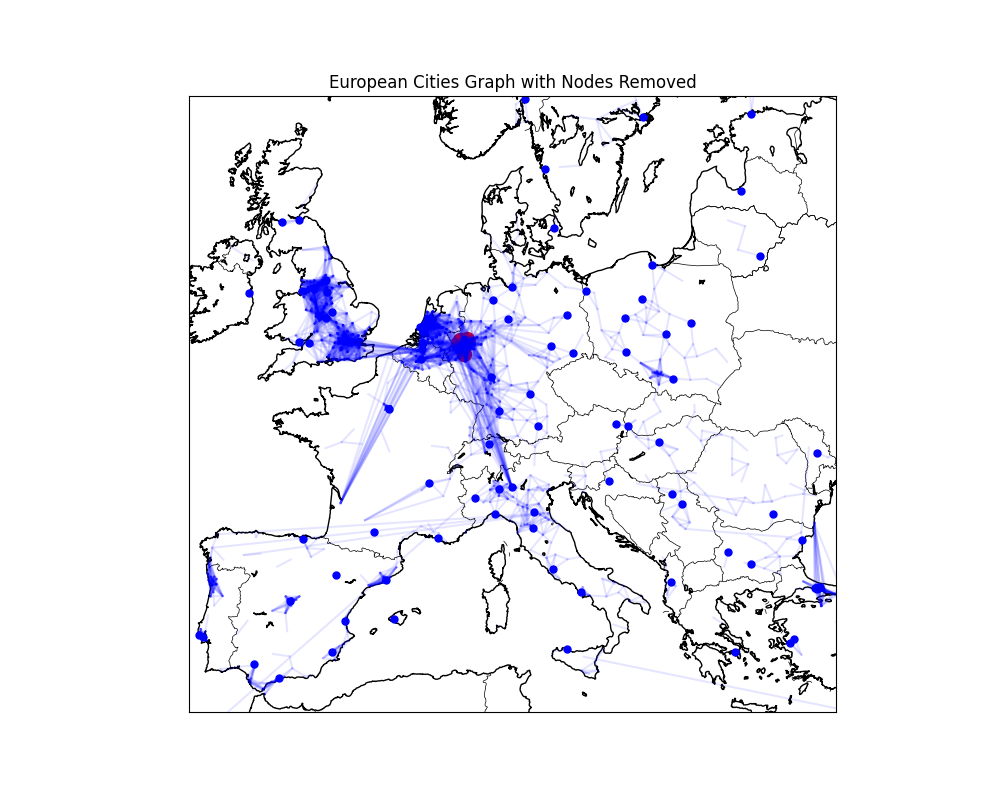
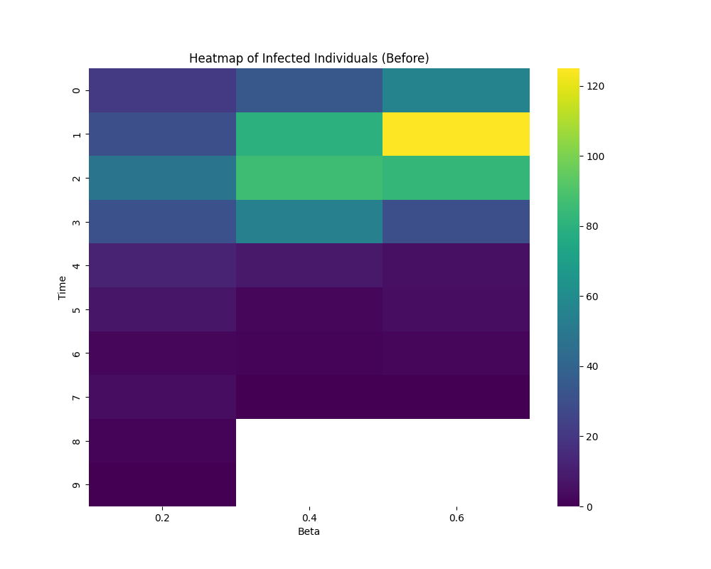
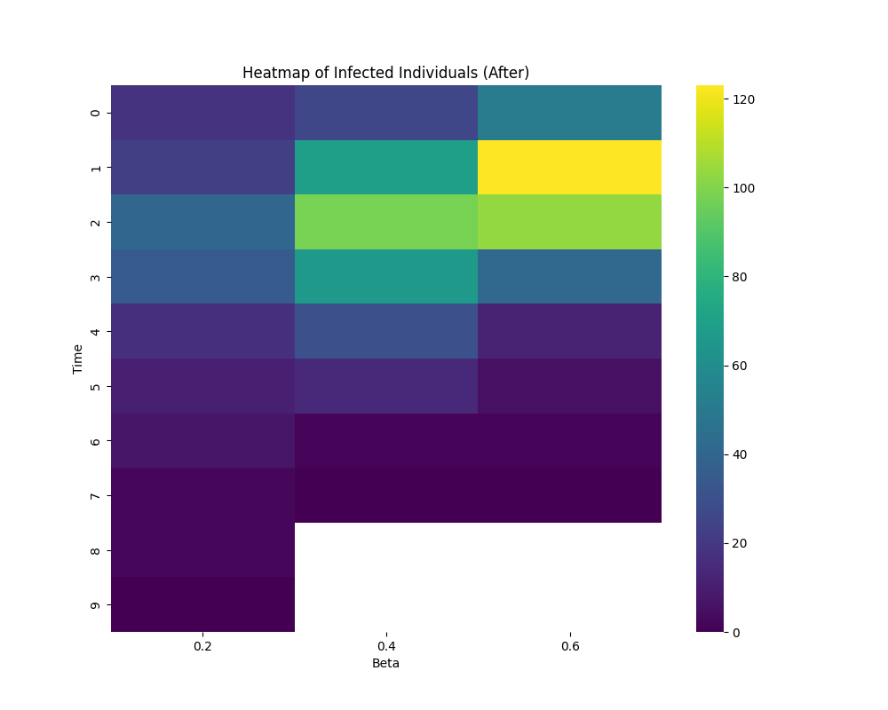

# Methodology

This note summarises the methods in my [third-year SF5 report](reports/kad54_SF5_final_report-3.pdf) and clarifies how the surviving code implements them.

## 1. City network and inputs

Cities are nodes in an undirected graph. Two cities are connected when their distance is at most 100 km. Population and coordinates come from the city table; distances are computed using Geopy. The distance script covers the 1,000 largest population rows, while the graph includes the wider city table, leaving many isolated nodes.

The temperature preparation script obtains daily 2023 weather through Meteostat and supplies a synthetic seasonal temperature profile where observations are unavailable. The saved inputs mix these sources. The SIR code averages temperatures by city after parsing dates in the `index` column; fallback dates stored only in `time` are not included.

Nodes are identified by city name, so cities sharing a name can be merged. Population is stored as an attribute but does not weight the simulated city counts. The graph is a geographical approximation of connectivity, rather than a measured transport or mosquito-movement network.

## 2. SIR model

The report introduces the standard susceptible–infected–recovered equations:

$$
\frac{dS}{dt}=-\beta\frac{SI}{N},\qquad
\frac{dI}{dt}=\beta\frac{SI}{N}-\gamma I,\qquad
\frac{dR}{dt}=\gamma I,
$$

where $N=S+I+R$, $\beta$ is the transmission rate and $\gamma$ is the recovery rate. The report specifies $\gamma=0.1$.

The city-network code uses a **discrete stochastic SIR process** rather than solving these equations. Each infected city attempts to infect susceptible neighbours and then recovers after one step. Newly infected cities transmit in the next step, and the simulation stops when none remain infected. The function accepts `gamma` but does not use it.

The final recovered count represents the number of cities ever infected, including the initial infected cities. It does not represent a count of recovered people or clinical observations.

## 3. Temperature-dependent transmission

The report describes a linear temperature relationship:

$$\beta(T)=\beta_0+\alpha(T-T_{\min}).$$

In the code, retained annual city means are scaled to a transmission multiplier:

$$
\lambda_v=0.1+0.4\frac{T_v-T_{\min}}{T_{\max}-T_{\min}},\qquad
p(u\rightarrow v)=\beta\lambda_v.
$$

Here $T_v$ is the destination city's mean temperature and $\beta$ is swept over 0.2, 0.4 and 0.6. A city without a retained mean receives temperature zero in the original code. This is an illustrative assumption, not a fitted mosquito transmission relationship. The runnable entry point reports invalid probability inputs rather than silently changing them.

## 4. Centrality measures

The report considers four established measures:

| Measure | Meaning | Definition in the report |
| --- | --- | --- |
| Degree | Number of direct connections | $C_D(v)=\deg(v)/(N-1)$ |
| Betweenness | Position on shortest paths between other cities | $C_B(v)=\sum_{s\ne v\ne t}\sigma_{st}(v)/\sigma_{st}$ |
| Closeness | Short path lengths to other cities | $C_C(v)=(N-1)/\sum_{t\ne v}d(v,t)$ |
| Eigenvector | Connections to other influential cities | Leading eigenvector of the adjacency matrix |

In the betweenness expression, $\sigma_{st}$ counts shortest paths from $s$ to $t$, and $\sigma_{st}(v)$ counts those through $v$. The code uses NetworkX defaults without distance weights; its disconnected-graph closeness adjustment differs from the compact report formula.

## 5. Combined removal strategy

Appendix A describes calculating all four centralities, dividing each by its maximum value and taking their mean:

$$
C(v)=\frac{1}{4}\sum_{m\in\{D,B,C,E\}}
\frac{C_m(v)}{\max_w C_m(w)}.
$$

The five highest-scoring cities and their edges are removed. Scores are calculated once, before removal. This combines existing centrality measures for the coursework comparison; it is not presented here as a new centrality method.

The available experiment samples 200 initially infected cities, runs the baseline, removes five cities and repeats using surviving seeds. If a removed city was initially infected, the intervention also changes the initial infected count. Before and after runs use different random draws. The original historical seed was not recorded.

## 6. Report results

The following values are read from Figure 1:

| Strategy | $\beta=0.2$ | $\beta=0.4$ | $\beta=0.6$ |
| --- | ---: | ---: | ---: |
| Before control | 305 | 349 | 489 |
| Degree | 303 | 345 | 469 |
| Betweenness | 299 | 349 | 427 |
| Closeness | 302 | 336 | 401 |
| Eigenvector | 299 | 337 | 401 |
| Combined | 299 | 343 | 357 |

Combined centrality gives the smallest final recovered count in the displayed $\beta=0.6$ run. At $\beta=0.4$, closeness gives the smallest count, while several strategies tie at $\beta=0.2$. The report's prose sometimes favours degree or treats more recovered cities as better, which conflicts with interpreting this count as cumulative outbreak size. The PDF remains unchanged.

The original network and heatmap figures are included below for context:

These are extracted report images. The city model counts infected cities, although the report heatmap captions refer to individuals.

## 7. Interpretation and available code

The figures illustrate a modelling exercise. The surviving `results.py` implements combined removal.

`model.py` retains the original SIR and combined-removal function bodies. `experiment.py` and `main.py` were added during repository preparation to provide configurable paths, seeds and saved outputs. They support rerunning the available comparison and do not reconstruct missing experiments or change the recovery rule.

Potential extensions mentioned in the report include incorporating mobility, mosquito and disease observations, and adapting control to changing conditions. Repeated simulations and clearer data identifiers would also help assess the example more reliably.
